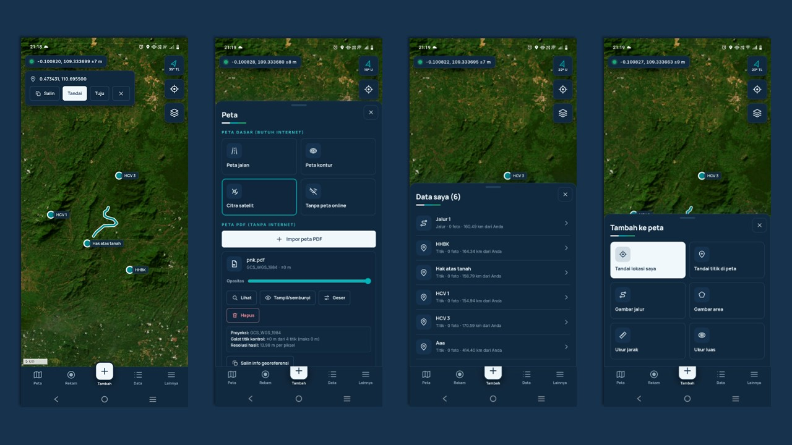

# TAPAK

**Teknologi Akuisisi dan Pencatatan Hutan Kita**
*Every Track Tells a Story.*

Aplikasi Android untuk pemetaan, navigasi, dan pencatatan lapangan yang tetap berfungsi tanpa internet.

> Dikembangkan oleh **Spectra Citra Cendekia (Spectra CC)** · *Turning Spatial Insight into Practical Solutions.*

*Tampilan TAPAK (dari kiri): peta dengan titik dan jalur, pengaturan peta dasar dan peta PDF offline, daftar data saya, dan menu tambah objek ke peta.*

---

## Tentang TAPAK

Banyak masyarakat lokal belum punya akses ke alat navigasi dan pelacakan spasial untuk mendokumentasikan kegiatan konservasi dan memantau sumber daya alam di wilayahnya. **TAPAK** hadir sebagai alat berbasis Android yang mudah dipakai, sehingga masyarakat dapat mengumpulkan data lokasi, melacak kegiatan lapangan, dan mendokumentasikan upaya konservasi hanya dengan smartphone yang sudah mereka miliki, tanpa biaya tambahan.

### Untuk siapa

- Tim **patroli hutan** dan pengamanan kawasan
- Petugas **survei dan inventarisasi** (flora, fauna, tapak, tutupan lahan)
- Pendamping masyarakat dalam **pemetaan partisipatif**
- Tim **restorasi dan penanaman**, termasuk pemantauan lokasi tanam
- Siapa pun yang butuh catatan lapangan berkoordinat tanpa harus selalu online

### Prinsip

- **Offline.** Internet tidak wajib untuk pekerjaan inti.
- **Data tersimpan secara lokal.** Semua catatan tersimpan di HP. TAPAK tidak punya server dan tidak mengunggah data Anda ke penyimpanan lain.
- **Mengikuti standar formatting data GIS.** Hasil bisa dibawa ke QGIS, ArcGIS, atau Google Earth tanpa konversi rumit.
- **Sederhana.** Antarmuka berbahasa Indonesia, dirancang untuk dipakai sambil berjalan.

| | |
|---|---|
| **Nama** | TAPAK |
| **Versi saat ini** | **1.6.1** |
| **Platform** | Android 7.0 atau lebih baru |
| **Bahasa** | Indonesia |
| **Pengembang** | Spectra Citra Cendekia (Spectra CC), Pontianak, Kalimantan Barat |

---

## Apa yang bisa dilakukan TAPAK

### 1. Memakai peta, online maupun offline

- **Peta offline dari GeoPDF.** Peta yang Anda siapkan di QGIS atau ArcMap dapat diimpor ke HP. Posisi Anda tampil tepat di atas peta tersebut, lengkap dengan pengaturan transparansi dan geser manual bila perlu kalibrasi.
- **Peta online gratis** (jalan, kontur, citra satelit) saat ada internet.
- Fitur navigasi dan pemetaan, termasuk **GPS, kompas, dan skala**, selalu tersedia di layar.

### 2. Mencatat temuan lapangan

- **Titik:** tandai lokasi dari GPS atau dengan mengetuk peta.
- **Jalur dan area:** gambar garis dan poligon, lalu lihat jarak dan luasnya.
- **Atribut bebas:** isi keterangan sesuai kebutuhan survei Anda (jenis, kondisi, jumlah, catatan).
- **Foto bergeotag:** lampirkan foto pada objek; koordinat tersimpan di dalam fotonya.
- **Simbol dan warna:** bentuk, warna, dan gaya garis dapat diatur, atau diwarnai otomatis menurut atribut “Jenis”.
- **Elevasi:** ketinggian dengan koreksi geoid, profil elevasi, dan kalibrasi.
- **Batas akurasi GPS:** atur batas ketelitian (*default* min. 32 m); titik yang kurang akurat diberi peringatan atau ditolak.
- **Cari, saring, sembunyikan,** dan pilih banyak objek sekaligus.

### 3. Merekam jejak perjalanan (tracking)

- Rekam jalur yang Anda tempuh, dengan pilihan interval 2 detik, 30 detik, semua titik, atau sesuai keinginan.
- Bisa **dijeda dan dilanjutkan**. Jarak selama jeda tidak ikut terhitung.
- **Tetap merekam** saat layar dikunci atau aplikasi diminimalkan.
- Notifikasi di bilah status menunjukkan keadaan rekaman: hijau **“Sedang tracking”** dan oranye **“Track dijeda”**.
- Rekaman yang terputus, misalnya karena HP restart, dapat dilanjutkan saat TAPAK dibuka lagi.

### 4. Membawa data keluar

- **Ekspor data** ke **GeoJSON, KMZ, dan Shapefile (SHP)**: semua objek, yang dipilih, atau yang sedang tampil. Keluaran berformat zip yang berisi file data spasial dan lampiran (foto, jika ada).

### 5. Bantuan dan dukungan di dalam aplikasi

- Kartu pengenalan fitur saat pertama kali dipakai.
- **Laporkan bug / penyalahgunaan** langsung dari menu Lainnya.

---

## Alur kerja yang disarankan

1. **Persiapan di kantor.** Siapkan peta GeoPDF area kerja, lalu impor ke TAPAK selagi masih ada internet.
2. **Di lapangan.** Nyalakan tracking, tandai titik dan area, ambil foto, isi atribut.
3. **Sepulang lapangan.** Ekspor ke KMZ atau SHP untuk diolah di GIS, atau buat peta berlayout PDF untuk laporan.

---

## Yang perlu diketahui

**Kebutuhan perangkat**

| | |
|---|---|
| **Android** | 7.0 atau lebih baru |
| **Sensor** | GPS (disarankan) dan kompas; kamera bersifat opsional |
| **Izin** | Lokasi presisi, kamera, dan notifikasi (Android 13 ke atas) |
| **Internet** | Tidak wajib. Hanya untuk peta online dan mengirim laporan bug |
| **Baterai** | Di Xiaomi, Oppo, Vivo, Samsung, dan sejenisnya, atur baterai TAPAK ke “Tanpa batasan” agar rekaman latar belakang stabil |

**Tips pemakaian**

- Titik kontrol GeoPDF dibaca sebagai WGS84. Peta berdatum lokal dapat bergeser sedikit; gunakan fitur **Geser** untuk kalibrasi.
- Ketelitian elevasi dari GPS HP biasanya 2–3 kali lebih rendah daripada ketelitian horizontal.
- Peta online tidak disimpan untuk offline. Untuk daerah tanpa sinyal, gunakan GeoPDF.

**Batasan saat ini**

- Belum ada impor GeoJSON, KML, atau SHP.
- Belum bisa mengedit titik sudut (vertex) setelah objek disimpan.
- Belum diuji di semua merek dan versi Android.
- Belum dapat mencetak peta (PDF, PNG, JPEG) hasil pemetaan secara langsung.

---

## Privasi dan keamanan

- Semua data (objek, foto, jejak, peta) disimpan **hanya di HP Anda**. Tidak ada akun dan tidak ada server TAPAK.
- Koneksi internet hanya dipakai untuk memuat peta online dan, bila Anda sendiri yang mengirim, laporan bug.
- Berkas peta yang diimpor diperiksa sebelum dibuka.
- Cadangan otomatis Android dimatikan agar data lapangan tidak berpindah tanpa sepengetahuan Anda.

Untuk melaporkan celah keamanan, lihat [SECURITY.md](SECURITY.md).

---

## Hubungi Kami

Pertanyaan, masukan, kerja sama, atau permintaan pelatihan dan penyesuaian TAPAK untuk organisasi Anda:

**<https://spectracc.sbs>**

Silakan gunakan halaman kontak di website tersebut.
Spectra Citra Cendekia (Spectra CC) · Pontianak, Kalimantan Barat, Indonesia.

---

## Atribusi dan lisensi

Peta dasar online: © kontributor OpenStreetMap; tampilan kontur © OpenTopoMap (CC-BY-SA); citra: Esri, Maxar, Earthstar Geographics, dan komunitas pengguna GIS.

TAPAK memanfaatkan sejumlah pustaka sumber terbuka (antara lain Leaflet, pdf.js, proj4, JSZip, dan Capacitor), masing-masing dengan lisensinya sendiri. Logo dan identitas visual Spectra CC mengikuti *Brand Identity & Strategic Guideline* v1.0 (Spectra Citra Cendekia, AHU-015113.AH.01.30 Tahun 2025).

**Lisensi kode TAPAK:** [Apache License 2.0](LICENSE) © 2026 Spectra Citra Cendekia. TAPAK adalah perangkat lunak sumber terbuka (*open-source*): Anda bebas memakai, mempelajari, mengubah, dan membagikannya, termasuk untuk keperluan komersial, dengan tetap mencantumkan hak cipta dan lisensi ini.

**Merek tidak ikut dilisensikan.** Nama TAPAK, logo, dan identitas visual Spectra CC adalah milik Spectra Citra Cendekia dan tidak diberikan lewat lisensi kode. Jika Anda membuat versi turunan, gunakan nama dan identitas visual sendiri.

Untuk pelatihan, penyesuaian, atau kerja sama pengembangan, lihat bagian [Hubungi Kami](#hubungi-kami).
